  

  
  
  
  

---

### 🐺 `whoami` & Oak Studio

Desarrollador y estudiante enfocado en la creación de software funcional, soluciones a medida y herramientas de alta precisión.

- 💻 **Desarrollo:** C++ · *Aprendiendo:* Java, Python, TypeScript, JavaScript.
- 🏢 **Host:** Lion Store — Soluciones a medida & Software funcional.
- 🛠️ **Entorno:** Windows 11, WSL, iOS · Visual Studio & Antigravity.
- 🌲 **Proyectos en [Oak Studio](https://evnwlf.dev/oak):**
  - **[Elisabette](https://evnwlf.dev/oak/elisabette)** — Lector de libros y experiencia editorial sin distracciones.
  - **[Oak Provoke](https://evnwlf.dev/oak/oak-provoke)** — Estudio de revelado y fotografía análoga de alto contraste.
  - **[Oak Camera](https://evnwlf.dev/oak/oak-camera)** — Cámara manual y captura pura sin procesamiento algorítmico.

---

  Diseñado con la estética editorial y de terminal de <b>evnwlf.dev</b>

